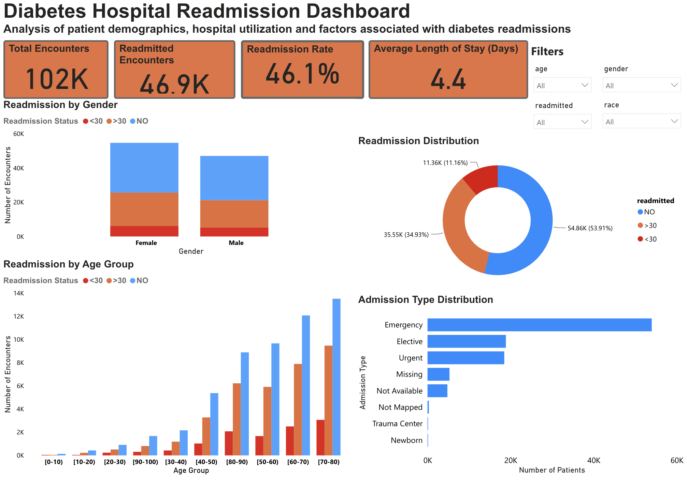
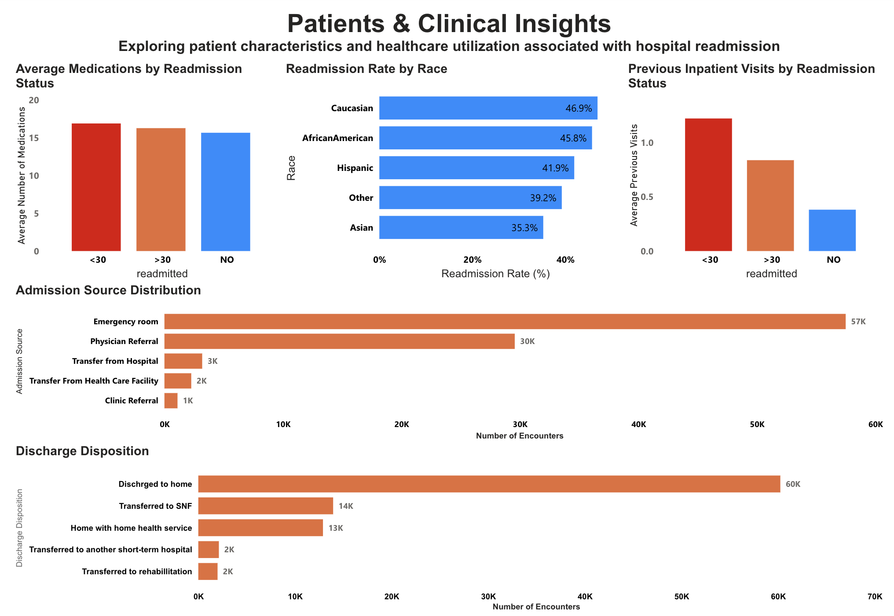

# Diabetes Hospital Readmission Analysis

## Project Overview

This project investigates hospital readmission patterns among patients with diabetes using the Diabetes 130-US Hospitals dataset.

The analysis combines **SQL Server** for data exploration, cleaning and analysis with **Power BI** for interactive data visualisation.

The objective is to identify patterns in hospital readmissions and examine how patient demographics, admission characteristics and healthcare utilisation relate to readmission outcomes.

## Project Objectives

- Explore patient demographics and hospital admission characteristics.
- Assess and address data quality issues.
- Analyse readmission patterns across demographic groups.
- Examine hospital length of stay, medication utilisation and previous inpatient visits.
- Develop an interactive Power BI dashboard to communicate findings.

## Dataset

**Source:** Diabetes 130-US Hospitals dataset (1999–2008), available from the UCI Machine Learning Repository.

The dataset contains 101,766 hospital encounters involving patients with diabetes across 130 US hospitals.

Readmission status is categorised as:

- **NO:** No recorded readmission.
- **<30:** Readmission within 30 days.
- **>30:** Readmission after 30 days.

The dataset contains encounter-level records, meaning some patients may appear more than once.

## Tools and Technologies

| Tool | Purpose |
|---|---|
| SQL Server | Data exploration, cleaning and analysis |
| Power BI | Interactive dashboard development |
| DAX | Readmission rates and healthcare utilisation measures |
| GitHub | Project documentation and version control |

## Project Workflow

### 1. Data Exploration

Explored the dataset using SQL to understand patient demographics, readmission categories, admission types, discharge dispositions and clinical characteristics.

### 2. Data Cleaning

Investigated missing and invalid categorical values, including unknown gender records, and prepared the dataset for analysis.

### 3. Readmission Analysis

Used SQL aggregation, grouping and filtering to investigate readmission patterns across patient and hospital characteristics.

### 4. Power BI Dashboard

Developed a two-page interactive report.

**Page 1 — Hospital Readmission Overview**

Includes total hospital encounters, readmitted encounters, overall readmission rate, average length of stay, demographic comparisons and admission type distribution.



**Page 2 — Patients & Clinical Insights**

Explores readmission rates by race, medication utilisation, previous inpatient visits, admission sources and discharge destinations.



## Key Findings

- The overall recorded readmission rate was approximately **46.1%**.
- The average hospital length of stay was **4.4 days**.
- Readmission rates varied across racial groups, ranging from **35.3% among Asian encounters** to **46.9% among Caucasian encounters** in the analysed data.
- Encounters followed by readmission within 30 days had higher average previous inpatient visits and medication counts than encounters without recorded readmission.
- Emergency room admissions and physician referrals were the most common admission sources.
- Discharge to home was the most common discharge disposition.

These findings describe associations and should not be interpreted as evidence of causation.

## Repository Structure

```text
diabetes-readmission-analysis/
├── data/
│   └── diabetic_data.csv
├── notebooks/
│   └── README.md
├── powerbi/
│   ├── Diabetes_Readmission_Analysis_Dashboard.pbix
│   ├── page1_overview.png
│   ├── page2_clinical_insights.png
│   └── README.md
├── reports/
│   ├── project_summary.md
│   └── README.md
├── sql/
│   ├── 01_data_exploration.sql
│   ├── 02_data_cleaning.sql
│   ├── 03_Readmission_analysis.sql
│   └── README.md
└── README.md
```

## Limitations

- The dataset contains historical US hospital encounters and may not reflect current healthcare practice.
- Some patients have multiple hospital encounters.
- Missing or unavailable values affect some variables.
- The analysis is descriptive and does not adjust for potential confounding factors.
- The dataset does not support analysis of calendar-based readmission trends.

## Conclusion

This project demonstrates the application of SQL and Power BI to healthcare data analysis. It highlights patterns in hospital readmissions and illustrates how analytical findings can be communicated through interactive dashboards.

The project demonstrates practical skills in data exploration, data cleaning, SQL querying, DAX calculations, data visualisation and healthcare analytics.

## Data Source

UCI Machine Learning Repository — Diabetes 130-US Hospitals for Years 1999–2008.

https://archive.ics.uci.edu/dataset/296/diabetes+130+us+hospitals+for+years+1999+2008
